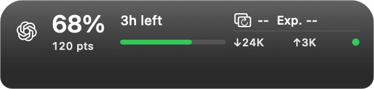

# Usage Topbar

**简体中文** · [English](README.en.md)

> 0.6.26 已撤回正式发布；相关历史与颜色功能仍在审查，当前稳定下载为 0.5.0。已安装的应用不会自动降级。

为 Apple Silicon Mac 打造的液态玻璃风格轻量工具：把 Codex 剩余额度、周期、重置倒计时、points 和整机网速放在窗口边缘与菜单栏。

运行 Codex 时，一眼就能看到剩余额度，无需点击左下角头像、进入二级菜单查看。把额度信息放在视线内，有助于缓解使用过程中的额度焦虑。

**公开版本：0.5.0（build 24） · Apple Silicon（arm64） · macOS 13+**

[下载 DMG](https://github.com/ALEXESLAT/usage-topbar/releases/download/v0.5.0/UsageTopbar-0.5.0-macOS-arm64.dmg) · [下载 ZIP](https://github.com/ALEXESLAT/usage-topbar/releases/download/v0.5.0/UsageTopbar-0.5.0-macOS-arm64.zip) · [发布页](https://github.com/ALEXESLAT/usage-topbar/releases/tag/v0.5.0) · [安装与使用](docs/USAGE.md) · [更新记录](CHANGELOG.md) · [问题反馈](https://github.com/ALEXESLAT/usage-topbar/issues)

*由 0.4.0 实际界面组件渲染，使用模拟数据和静态深色背景；不展示实时 Liquid Glass 折射。*

**0.6.26 新增本机额度历史**：四天概览、可滚动七天详情、重置事件和三个月记录；后台串行保存，隐藏历史窗口不执行数据刷新。

历史窗口保留系统关闭控件，隐藏独立标题文字并将标题栏融入内容；空白区可拖动。历史详情提供左轴、交点百分比与底部时间三个独立标签；四天小浮窗使用单个轻量百分比和定位点，点击进入七天详情。本地控制和构建默认使用独立 Testing 应用，正式应用需显式选择 `USAGE_TOPBAR_CHANNEL=release`；测试迭代不替换正式版。

历史提示与“回到现在”使用 macOS 26+ 原生 Liquid Glass，旧系统降级为材质；降低透明度时使用实色。界面沿用有效主题来源，运行时更新深浅外观；图表数据层不叠加玻璃。

测试版右键菜单 → **渐变设置…** 可编辑主额度进度条的固定渐变。支持色标增删/拖动、颜色与透明度，先预览，再保存或取消；额度减少只从右侧裁切。历史背景采用完整模糊和自适应底色，避免后方文字干扰。

## 功能

- 显示 Codex 剩余额度、最受限周期、重置倒计时和 points。
- 浮层跟随前台 Codex/ChatGPT 窗口；菜单栏可刷新、隐藏或退出。
- 显示整机上下行速率。未知额度显示 `--%`，有效零值显示 `0%`。
- macOS 26+ 使用原生 Liquid Glass，较早系统使用 SwiftUI 材质。

## 开始使用

1. 使用 Apple Silicon Mac（macOS 13+），安装并登录提供 app-server 的 Codex/ChatGPT 桌面应用。
2. 下载 DMG，将应用拖入“应用程序”；更新前先退出旧版。
3. 打开应用即开始已披露范围的监控，无需额外启动确认或输入 API key。

当前版本为 **ad-hoc 签名，未经过 Apple 公证**。首次打开可能被系统拦截；详见[安装、校验与故障排查](docs/USAGE.md)。不支持 Intel Mac。

## 更新与设置

- 0.4.0 用户需手动安装一次 0.5.0，此后使用菜单“检查更新…”。
- 从正式签名清单获取更新，验证下载后由用户确认安装和重启；默认不自动检查、下载或安装，不强制重启，不发送系统画像。
- 手动显示/隐藏浮层的选择会保存；已有开机自启状态不变。

没有自动健康回滚。更新流程、发布校验与恢复边界见[更新指南](docs/UPDATES.md)。

## 了解更多

[使用与隐私](docs/USAGE.md) · [开发与贡献](CONTRIBUTING.md) · [发布说明](RELEASE_NOTES.md) · [自动检查](https://github.com/ALEXESLAT/usage-topbar/actions/workflows/ci.yml)

通过本地 Codex app-server 向 OpenAI 读取用量；网卡统计和窗口处理在本机完成。0.6.26 将额度历史及账户/卡片 ID 的单向摘要保存在本机，保留三个月；不保存凭据，详细数据范围见使用指南。

已完成本机模拟回归、构建与渲染；旧系统、物理多屏/刘海组合和真实账户长时间运行尚未实机覆盖。采用 [MIT 许可证](LICENSE)，版权署名 © 2026 ALEXESLAT。

> 本程序及文档由人工智能编写。
